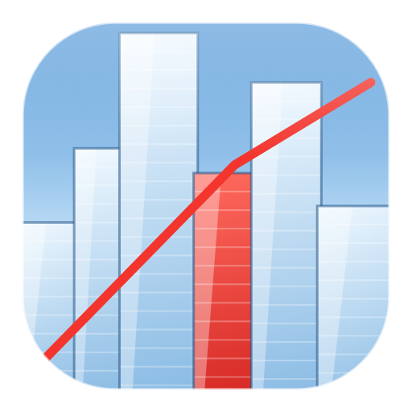

  

<h1 align="center">RunnerRecompiled for macOS</h1>

  An unofficial, fan-made native <b>macOS (Apple Silicon)</b> port of the Windows PC version of <i>Mirror's Edge</i> (2008).

Based on [singlemate/RunnerRecompiled](https://github.com/singlemate/RunnerRecompiled), with this fork's focus on
**Apple Silicon Macs**.

The game's x86 code is **lifted to C ahead of time** and compiled for arm64. It is not emulated and does not run
through Wine, Rosetta or a translation layer. Direct3D 9 goes through DXVK on MoltenVK (Vulkan on Metal). The
enhanced PhysX effects run on native arm64 solvers.

> **Status: playable.** The title screen, menus, the tutorial and later chapters play at 60 fps with the PhysX
> effects on, with keyboard and mouse or natively with a game controller (Xbox, PlayStation, Switch Pro and other
> controllers macOS supports). A few rough edges remain, see [Known issues](#known-issues).
> **Pull requests are welcome.**

**No game files are included or linked.** You need your own copy of the game from GOG. This repository holds only
original code, patches and notes. Nothing built from your copy (lifted C, catalogs, rebased DLLs, binaries) may be
shared.

## Tested on

| | |
|---|---|
| Machine | MacBook Pro, Apple M1 Max |
| OS | macOS 15 (Sequoia) |
| Game | GOG *Mirror's Edge* 1.01 (`MirrorsEdge.exe` SHA-256 `58de3df2…a3dd`) |
| Toolchain | Homebrew LLVM 23, MoltenVK, SDL3 |

Other Macs and macOS versions have not been tested. Other releases of the game (Steam, EA App, retail) will not work:
the lifted code is tied to this exact executable.

## How the port works

### The lifter (x86-32 → C → arm64)

A purpose-built static recompiler in `pc/tools/` (design: [`pc/LIFTER-DESIGN.md`](pc/LIFTER-DESIGN.md)):

- **Function catalog.** Recursive disassembly of the PE32 executable from every seed it can find: the entry point,
  direct calls, SafeSEH handlers, relocations into code (vtables, C++ EH funclets, UnrealScript native tables), import
  thunks and `switch` jump tables. On the GOG executable that is about **178,600 functions** and **5.7 million
  instructions**, with every jump table resolved and no decode errors in reachable code.
- **Lifting.** Each guest function becomes a C function over a CPU context: lazy EFLAGS, an x87 stack, SSE on NEON,
  string instructions, `lock`-prefixed atomics. Direct calls are direct C calls; indirect calls go through an O(1)
  guest-address table.
- **Everything is lifted, not just the game.** The PhysX 2.8 DLLs, Ogg/Vorbis, Bink and the Visual C++ 2005 runtime
  (`msvcr80`/`msvcp80`) are rebased and lifted the same way, so the game runs against its real libraries.
- **Runtime** (`pc/runtime/`): PE loader in a 4 GB guest address space (on 16 KB host pages), threads and TLS, guest
  SEH and C++ exceptions, and the Win32 surface the game uses (kernel32, user32, files, synchronization).
- **Controllers.** Gamepads connect natively through SDL3 and reach the game as XInput pads, so Xbox, PlayStation,
  Switch Pro and other macOS-supported controllers work without extra drivers. Buttons can be remapped and look
  inverted in the launcher.
- **Graphics.** A generated D3D9 bridge hands the game's Direct3D 9 calls to DXVK 3.1.1, patched for macOS:
  SDL3 windowing, depth-compare emulation for MoltenVK, deferred resource destroy (fixes the lost GPU device on level
  loads), and per-map pipeline warm-up. Patch: [`pc/dxvk/dxvk-3.1.1-macos.patch`](pc/dxvk/dxvk-3.1.1-macos.patch).

### PhysX enhancements

The "enhanced" PhysX effects (glass shards, debris, smoke, steam, banners and cloth) are too slow on the lifted PhysX
core. The port runs them on [Shatter](https://github.com/Arecsu/shatter)'s native fluid and cloth solvers, compiled
for arm64 with sse2neon and wired into the lifted game through guest-memory vtables and thunks. Rigid bodies, joints and
queries stay on the lifted PhysX core. Details: [`pc/shatter/UPSTREAM.md`](pc/shatter/UPSTREAM.md).

Measured on the M1 Max, same levels, PhysX on:

| | cloth on the lifted core | cloth and fluids native |
|---|---|---|
| in-level seconds below 50 fps | 20% | 9% |
| frames over 25 ms per minute | 175 | 41 |
| lifted PhysX time per frame (worst average) | 16.0 ms | 0.6 ms |

The solver output on arm64 is bit-identical to x86-64 SSE2 on all 13 upstream test scenarios. Shatter's slide-steering
fix (for frame rates above 62 fps) is ported too, off by default (`PXSHIM_SLIDEFIX=1`).

### Launcher

`pc/launcher/macos/` builds a small SwiftUI app (`MirrorsEdgeLauncher.app`, the icon above) for resolution, render
scale, vsync and frame limit, PhysX on/off, field of view, mouse and controller options, upscaling (experimental
MetalFX), HUDs and logging. It writes `TdEngine.ini` and starts the game. No game art is shipped with it.

## Known issues

These are known and being worked on. In practice the game generally plays fine on the **second run** of a level,
once the shader and pipeline caches have warmed up.

- **The level freezes when it starts: this is shader compilation. Please wait for it to load.** The game has not
  hung. MoltenVK compiles every new render-state/shader combination on demand, so the first time a level starts the
  picture can freeze for a long time (tens of seconds, sometimes up to a minute) and hitch while you move through it.
  Leave it running and it carries on by itself. The DXVK
  patch records these per map and rebuilds them on the next visit, which brings the start down to a few seconds
  (issue [#1](https://github.com/prasys/RunnerRecompiled/issues/1)).
- **Occasional freezes on heavy scenes**, mostly the first time through.
- **An intermittent crash during level loads.**
- Not checked yet: audio quality, the startup movie, a full playthrough to the end.

## Troubleshooting

Most of these are switches in the launcher (tab in brackets). Without the launcher, set the environment variable
before starting `me_pc`.

| Problem | Try | Launcher | Environment |
|---|---|---|---|
| Freezes or long holds when a level starts or the screen stops updating | Turn off the pipeline warm-up | Game → *Pipeline warm-up* | `DXVK_PIPELINE_WARM=0` |
| Warm-up holds the picture too long | Lower the hold cap (default 10 s) | Game → *Warm-up wait cap* | `DXVK_PIPELINE_WARM_WAIT_MS=3000` |
| Stalls got worse after a game or DXVK update, or saved warm-up data looks broken | Clear the warm-up data for a cold start (optionally DXVK's shader cache too) | Game → *Clear warm-up data* | delete `~/.cache/dxvk/pipelines.warm*` |
| Stutter or slowdown in scenes with glass, smoke or cloth | Make sure the effects run on Shatter, or turn the PhysX effects off | Graphics → *Enhanced PhysX* / *Shatter* | `ME_PC_SHATTER=1` (default); `PhysXEnhanced=False` in `TdEngine.ini` |
| Odd cloth (banners, tarps) | Leave cloth to the lifted PhysX core | Graphics → *Cloth on Shatter too* | `PXSHIM_CLOTH=0` |
| Low frame rate, hot Mac | Set upscaling to Standard and lower the quality (render scale), cap the frame rate, keep vsync on | Graphics → *Upscaling* / *Quality* | `ME_PC_UPSCALER=dxvk ME_PC_RENDER_SCALE=0.75` |
| Tearing, or uneven pacing on a 120 Hz screen | Turn vsync on | Graphics → *Vsync* | `ME_PC_VSYNC=1` |
| Image looks wrong with MetalFX | Switch upscaling back to Native or Standard (MetalFX is experimental) | Graphics → *Upscaling* | unset `ME_PC_UPSCALER` |
| Can't steer on steep slides above 62 fps | Turn on the slide-steering fix, or cap at 60 | Graphics → *Slide steering fix* | `PXSHIM_SLIDEFIX=1` |
| Mouse stuck in the window, or jumpy | Turn off mouse capture or mouse smoothing | Game → *Capture the mouse* / Graphics → *Mouse smoothing* | `ME_PC_MOUSE_CAPTURE=0` |
| Controller buttons swapped (e.g. Switch A/B) or look inverted | Remap the buttons, invert look | Controller | `ME_PC_PAD_MAP="A=B,B=A"`, `ME_PC_PAD_INVERT_Y=1` |
| Black bars on a 16:10 MacBook screen | Fill the screen (experimental) | Graphics → *Fill the screen* | `ME_PC_FILL_SCREEN=1` |
| Want PlayStation or Nintendo button icons | Pick the button icons | Controller → *Button icons* | `ME_PC_PAD_GLYPHS=ps` / `nintendo` |
| Want a quick 90° turn on the controller | Turn on the quick turn (D-pad left/right), experimental | Controller → *Quick 90° turn* | `ME_PC_QUICK_TURN=1 ME_PC_ACH_PATH=<file>` |
| Want to see what's happening | Metal HUD or DXVK HUD; log long waits | Graphics → *HUD*; Game → *Log waits* | `MTL_HUD_ENABLED=1`, `DXVK_HUD=fps`, `ME_PC_LOG_WAITS=500` |

If a level freezes, the second try is usually fine once its pipelines have been compiled. More switches are listed in
[`AGENTS.md`](AGENTS.md) ("Quick start") and [`pc/MACOS-BUILD.md`](pc/MACOS-BUILD.md) ("Pipeline warm-up").

Please report problems as GitHub issues on [`prasys/RunnerRecompiled`](https://github.com/prasys/RunnerRecompiled/issues),
with the console output and any `mvk-error` line.

## Future: the Xbox 360 version

This repository also holds a static recompilation of the **Xbox 360** version of the game (XenonRecomp for the
PowerPC code, its own Xbox kernel/XAM runtime, a patched RexGlue Vulkan GPU backend), written by
[singlemate](https://github.com/singlemate) in the original [RunnerRecompiled](https://github.com/singlemate/RunnerRecompiled)
project. It runs on Android today (`xbox/`, `android/`; progress log in [`CHECKLIST.md`](CHECKLIST.md)). Bringing it to
macOS alongside the PC port is future work.

## Contributing

Pull requests are welcome: bug fixes, testing on other Macs and macOS versions, performance work
on the known issues above, or the Xbox 360 path. Read [`AGENTS.md`](AGENTS.md) for repo rules and
[`pc/MACOS-PORT-PLAN.md`](pc/MACOS-PORT-PLAN.md) for where things stand. Never include game files or anything
generated from them.

## Building

Full step-by-step guide from a clean Mac: **[`pc/MACOS-BUILD.md`](pc/MACOS-BUILD.md)**. In short:

1. Install the Homebrew packages (LLVM 23, SDL3, MoltenVK, Vulkan loader, Meson, innoextract, …).
2. Extract your GOG installer into `work/pc` and check the executable's hash.
3. Extract `msvcr80`/`msvcp80` from the bundled redistributable and rebase the game's DLLs.
4. Build the function catalogs and DXVK (`pc/dxvk/build-macos.sh`).
5. Lift and compile: `python3 -I pc/tools/build_pc_runtime.py --macos /opt/homebrew/opt/llvm@23 --work work/pc-recomp`
   (about 7-8 minutes on an M1 Max).
6. Run `work/pc-recomp/bin-macos/me_pc` directly or through the launcher.

Everything derived from the game stays in the gitignored `work/` folder and must never be committed.

## Layout

| Path | Contents |
|---|---|
| `pc/tools/` | Lifter: PE32 parser, CFG/catalog, x86 → C lifter, module generator, build script, D3D9 bridge generator |
| `pc/runtime/` | Guest runtime: Win32 emulation, threads, exceptions, D3D9 bridge, macOS host layer |
| `pc/dxvk/` | DXVK 3.1.1 macOS patch and build script |
| `pc/shatter/` | Vendored Shatter solvers and the port layer into the lifted game |
| `pc/launcher/macos/` | SwiftUI launcher and icon generator |
| `pc/spikes/` | Experiments: address space, DXVK on MoltenVK, MetalFX, FSR |
| `pc/MACOS-PORT-PLAN.md` | Phases, measurements and decisions of the port |

## Credits

- **[singlemate](https://github.com/singlemate)** and the original [RunnerRecompiled](https://github.com/singlemate/RunnerRecompiled)
  project, which this port is forked from and builds on: the Xbox 360 static recompilation to native Android, its
  runtime and GPU work, and the project's structure and docs.
- **[XenonRecomp](https://github.com/hedge-dev/XenonRecomp)** (MIT) and the **[RexGlue SDK](https://github.com/rexglue/rexglue-sdk)**,
  derived from **[Xenia](https://github.com/xenia-project/xenia)** (BSD-style): the Xbox 360 recompiler and GPU backend.
- **[Shatter](https://github.com/Arecsu/shatter)** by Arecsu (MIT): the native PhysX fluid and cloth solvers and the
  slide-steering fix.
- **[DXVK](https://github.com/doitsujin/dxvk)** by Philip Rebohle and contributors (zlib): Direct3D 9 on Vulkan.
- **[MoltenVK](https://github.com/KhronosGroup/MoltenVK)** (Apache 2.0) and the Khronos Vulkan loader: Vulkan on Metal.
- **[SDL3](https://github.com/libsdl-org/SDL)** (zlib): windowing and input.
- **[LLVM](https://llvm.org)** (Apache 2.0 with LLVM exception): the disassembler behind the lifter and the compiler.
- **[sse2neon](https://github.com/DLTcollab/sse2neon)** (MIT): Shatter's SSE code on ARM NEON.
- Patches in this repository keep the license of the project they modify. Original code here: MIT, see
  [LICENSE](LICENSE).

*Mirror's Edge* is a trademark of Electronic Arts. RunnerRecompiled is an independent fan project; it is not
affiliated with, endorsed by or sponsored by EA or DICE. The game title is used only to say which game this project
works with.
